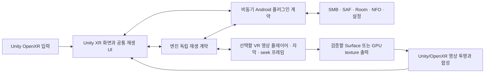

# Galaxy XR용 Unity/OpenXR 포팅 계획

작성일: 2026-10-12. 작업 브랜치: `port/galaxy-xr-unity`.

**현재 앱의 기능을 Galaxy XR용 Unity/OpenXR 앱으로 이전한다. 전체 XR UI를 이전하고, 기존 앱과 병행 설치한다. 재생 UI는 넓은 2단 재생 바를 공통 기준으로 사용한다. 기존 검토에서 도출된 기능 수정·추가 목록은 이번 포팅에 적용하지 않는다.**

최초 작성 작업에서는 계획 문서만 만들었다. 이후 사용자가 실제 포팅을 승인했고 Unity 프로젝트와 Editor·Android 모듈을 준비했다. 현재 프로젝트는 `G:\workspace\unity-stream-app\unity-xr-stream`이며, 도구 확인 결과는 6.1절에 기록한다. P1 실행 기반과 P2 출력 후보를 구현 중이다. 전체 기능 이전과 Galaxy XR 검증은 완료하지 않았다.

2026-10-13 작업 중단 기준점과 다음 우선순위는 [잔여 작업 목록](UNITY_OPENXR_REMAINING_TASKS.md)에 정리했다. 다음 작업은 seek preview 양안 출력 수정부터 재개한다.

## 1. 확정한 범위

| 항목 | 결정 |
| --- | --- |
| 실행 대상 | Galaxy XR의 Android XR 런타임 |
| 엔진 | Unity 6 + Unity OpenXR + Android XR 지원 패키지 |
| 이전할 화면 | 홈, 로컬/SMB 탐색, 파일·작품 상세, 설정, 플레이어, 현재 활성 온라인 화면 |
| Android 기능 | 기존 SMB, SAF 로컬 접근, Room, 설정, 메타데이터 로직을 우선 재사용 |
| 재생 엔진 | Media3 유지 의무 없음. Unity/OpenXR에 적합한 VR 영상 플레이어로 교체 가능. P2에서 검증 후 선택 |
| 앱 설치 | 기존 `blackark.app.vr`와 병행 설치하는 `blackark.app.vr.unity` |
| 데이터 | 앱 ID별 독립 DB·설정·캐시·자격 증명. 기존 앱 데이터 자동 이전은 하지 않음 |
| 재생 컨트롤 | 넓은 2단 재생 바 하나를 공유. seek preview 또는 설정 표시 여부로 배치를 바꾸지 않음 |
| 기존 검토 목록 | F01–F16 및 U01–U12의 기능 변경은 별도 후속 작업 |
| 레퍼런스 | SKYBOX와 DMM VR Player의 공개 UX. 해당 제품의 내부 구현이나 엔진을 추정하지 않음 |

Jetpack XR 및 Compose 화면을 유지해야 한다는 제약은 없다. Android 라이브러리를 사용하더라도 XR 화면과 입력의 실행 주체는 Unity/OpenXR 하나로 구성한다. 기존 Jetpack XR 세션과 Unity XR 세션을 동시에 생성하는 구조는 사용하지 않는다.

이번 단계의 완료 기준은 **현재 활성 기능의 이전과 동등성 검증**이다. 엔진 전환만으로 기존 자막·FOV·seek 문제를 해결했다고 판정하지 않는다.

재생 엔진은 Unity VideoPlayer, Unity용 VR 영상 플러그인, Media3 연동을 비교해 선택한다. 아래의 Media3·ExoPlayer·SMBDataSource 재사용 설명은 해당 엔진을 선택한 경우의 설계이며 필수 제약이 아니다. 교체 시 로컬/SMB·SAF 접근, 2D/180/360·Mono/SBS/TB, 한국어 ASS/SRT·트랙 선택, seek·이어보기·큐와 상태 저장을 새 엔진에서 검증한다. 특정 엔진의 API나 cue 타입을 그대로 유지할 의무는 없다.

## 2. 기준 소스와 변경 관리

- 기준 HEAD: `732f9b1` — `XR 재생 패널과 최근 항목 흐름 개선`.
- 검토 당시 작업 트리에는 이전 라이브러리 업데이트와 관련 코드 변경이 남아 있었다. 이 문서의 커밋에는 그 변경을 포함하지 않는다. 포팅 재개 시 사용할 의존성 기준을 먼저 커밋으로 고정한다.
- 기능 목록은 실제 활성 화면과 호출 경로를 기준으로 확정한다. 코드에 클래스가 존재한다는 이유만으로 비활성 기능을 새 메뉴에 노출하지 않는다.
- 원본 앱이 계속 빌드되는 상태를 유지하면서 별도 Unity 프로젝트와 Android 플러그인을 추가한다.
- 데이터 정책, 형식 판별, 그룹 식별과 미리보기 정책의 변경을 포팅 작업에 섞지 않는다. 이전에 필요한 기술 변경과 동작 변경을 구분해 기록한다.

기존 검토 문서는 작업 트리에 별도로 존재하지만 이 문서는 단독으로 읽을 수 있도록 범위와 보류 항목을 포함한다. 목업 PNG와 기존 미커밋 검토 자료는 이번 문서 커밋에 포함하지 않는다.

## 3. 화면과 동작의 이전 목록

### 3.1 홈과 기본 탐색

- 현재 활성 기본 탐색인 `홈 / 로컬 / SMB / YouTube / 설정`을 기준으로 이전한다.
- 홈의 이어보기와 빠른 접근 폴더, 카드 선택·상세·재생 흐름을 보존한다.
- 현재 열려 있는 소스, 실제 탐색 경로, 선택 항목과 스크롤 상태를 유지한다.
- 플레이어에서 복귀할 때 대시보드 위치·크기를 유지하는 동작을 Unity 좌표계로 이전한다.
- 현재 도달 가능한 라이브러리 상세·필터 기능은 기존 진입 경로에서 보존한다. 새 Library/Favorites 기본 탐색 항목과 전체 최근 기록 화면은 추가하지 않는다.
- 숨겨진 DMM/FANZA 기본 탐색을 자동 활성화하지 않는다. DMM을 UX 레퍼런스로 사용하는 것과 앱의 DMM 연동 노출은 별개다.

### 3.2 SMB와 로컬 파일 탐색

- SMB 서버 추가·수정·삭제·연결 시험, 저장된 서버 재연결, 게스트 및 자격 증명 접속을 보존한다.
- SMB share와 폴더 탐색, 정렬, 목록/썸네일 보기, 파일별 재생·즐겨찾기·삭제를 이전한다.
- 로컬 저장소는 SAF 폴더 선택과 영속 URI 권한으로 접근한다. 새 앱에서 별도로 폴더를 선택해야 한다.
- 빠른 접근 폴더 등록·열기·제거와 마지막 탐색 위치 복원을 유지한다.
- `japan/<배우>/`에서 작품 하위 폴더를 한 단계 펼치는 현행 동작과 파일의 실제 원본 경로를 유지한다.
- 한 폴더 또는 펼친 목록의 VR/flat 혼재를 지원한다. 표시 폴더를 기준으로 모든 파일에 같은 VR 형식을 적용하지 않는다.

### 3.3 메타데이터, 가상 그룹과 이미지

- 현행 NFO 읽기, 캐시, 온라인 보완, 작품·배우 상세, 메타데이터 관리와 현재 접근 가능한 필터를 이전한다.
- 현행 가상 그룹과 파트 목록, 파트 선택 재생 및 재생 큐의 구성 의미를 보존한다.
- 대표 포스터·일반 썸네일의 파트 재사용 범위를 유지한다. seek 및 이어보기 프레임을 대표 이미지로 대체하지 않는다.
- trailer의 작품 연결과 원본 부모 폴더 탐색, `extrafanart/`의 자연 정렬 슬라이드를 이전한다.
- 미리보기 토글·음량, 포인터가 떠나거나 화면이 닫힐 때 미리보기 재생과 디코더를 정리하는 동작을 보존한다.
- 현재 코드의 fallback과 오류 처리도 기준 동작으로 기록한다. 요청하지 않은 본편 앞부분 fallback 제거 및 trailer 실패 시 fanart 전환은 F01/F02로 남기며 이번 단계에서 수정하지 않는다. 목업의 예시 콘텐츠를 새 재생 정책으로 해석하지 않는다.
- NFO 수동값 보호, 그룹 식별 충돌 방지 및 대표 이미지 기준 개선은 후속 작업으로 남긴다.

### 3.4 재생과 설정

- 로컬·SMB 및 현재 활성 직접 재생 경로, 준비/오류/재시도·재생/일시정지·seek·배속·음량을 이전한다.
- 2D/VR180/VR360, Mono/SBS/TB, 파일별 판별·저장·복원과 현재 자동 판별 순서를 보존한다.
- 이어보기, 재생 기록, 이전/다음 영상, 재생 종료 후 큐 처리 및 종료 시 위치 저장을 유지한다.
- 오디오/자막 트랙 선택, 외부 한국어 ASS/SRT 발견, 자막 토글·글꼴·크기와 거리·수직 위치 설정을 이전한다.
- 현행 `FOV`라는 이름으로 노출된 `zoomLevel`/영상 표면 scale 조절의 의미와 저장값을 우선 보존한다. 이를 헤드셋의 광학 FOV 또는 눈별 projection 조절로 바꾸지 않는다.
- 현재 자막 거리·높이·UI 수평 위치의 허용 범위와 저장 규칙을 유지한다. 새로운 IPD, 눈별 오프셋이나 자막 보정 화면을 추가하지 않는다.
- 컨트롤이 표시될 때 자막을 숨기는 현행 정책을 우선 이전한다. 자막을 보면서 조절하는 개선은 F03/U07로 보류한다.
- 기존 3초 Recenter, UI 위치/따라오기 설정, 입력 잠금·해제와 자동 숨김을 이전한다.
- 설정의 언어·테마·배경 색인·손 입력·미리보기·자막·캐시/기록 초기화·런타임 설정을 이전한다. 초기화 확인 절차와 삭제 범위도 유지한다.

## 4. 공통 재생 UI: 넓은 2단 바

목업 `04-player-seek`의 넓은 2단 재생 바를 공통 기준으로 선택했다. `05-player-display`에 그렸던 압축 바는 채택하지 않는다. 실제 크기와 XR 공간에서의 배치는 구현·기기 검증 때 정하되, 다음 구조와 일관성을 지킨다.

```text
                          [seek preview 카드]
                                ↑ 탐색 위치
┌──────────────────────────────────────────────────────────────────┐
│ 현재 시간 ─────────────────── 타임라인 ───────────────── 전체 길이 │
│ 이전 / −10초 / 재생·정지 / +10초 / 다음   음량   기존 메뉴·조작    │
└──────────────────────────────────────────────────────────────────┘
                          [설정 패널은 별도로 표시]
```

| 상태 | 공통 바 | 추가되는 화면 |
| --- | --- | --- |
| 일반 재생, 컨트롤 표시 | 넓은 2단 바 | 없음 |
| 타임라인 탐색 | 같은 위치·폭·버튼 순서 | 탐색 위치에 연결된 preview 카드 |
| Display 등 설정 메뉴 표시 | 같은 위치·폭·버튼 순서 | 해당 설정 패널 |
| 입력 잠금/해제 대기 | 같은 배치와 현행 입력 정책 | 필요한 잠금 표시 |
| 컨트롤 숨김 | 현행 자동 숨김 정책 | 메뉴·preview도 현행 수명 정책에 따라 처리 |

- 미리보기나 메뉴를 열면서 타임라인과 재생 버튼을 옮기거나 바 높이를 압축하지 않는다.
- 설정 패널은 타임라인과 버튼의 클릭 영역을 덮지 않도록 배치한다. 미리보기와 메뉴의 동시 표시 가능 여부는 현행 상태 정책을 기준으로 정한다.
- 현재 Display 메뉴의 형식·스테레오·트랙·FOV·자막/UI 위치 항목과 현재 배속·음량·Recenter 조작을 빠짐없이 연결한다. 목업에 보이는 버튼 이름만으로 새 메뉴 상태를 추가하지 않는다.
- 같은 화면 폭에서 재생 상태별 레이아웃을 바꾸지 않는다. 다른 폭에 대한 반응형 배치는 같은 컴포넌트의 제약으로 처리하고 별도 UX 개편을 확대 적용하지 않는다.
- 타임라인 drag의 시작·이동·확정·취소는 기존 seek preview 세션과 연결한다. 기존 잠금과 재생 복원 정책을 보존한다.
- 새 ±1초 조작, 단계 버튼, 새 snap 격자와 스틱 탐색 정책은 추가하지 않는다.

## 5. 구현 구조



예상 디렉터리 구조:

```text
app/                         # 기존 Jetpack XR 앱
unity-bridge/                # 기존 Android 기능을 연결하는 AAR
G:/workspace/unity-stream-app/unity-xr-stream/  # 기존 별도 Unity 프로젝트
  Assets/XRStream/
    Runtime/                 # 화면·입력·상태 계약·수명
    Editor/                  # 프로젝트 설정·scene 생성·batch build
  Packages/                  # manifest와 잠금 파일
  ProjectSettings/           # Android/XR 설정
docs/UNITY_OPENXR_PORT_PLAN.md
```

### 5.1 Android 플러그인의 경계

1. `data/`, `network/` 및 필요한 `utils/`·`remote/` 로직을 UI와 분리해 AAR에서 재사용한다. `player/`와 Media3 의존성은 선택한 재생 엔진에 필요한 경우에만 포함한다.
2. `MainDashboardViewModel`과 `VideoPlayerViewModel`의 현재 동작을 기준으로, 비동기 요청과 상태 snapshot/event를 제공하는 작은 facade를 만든다. AndroidX ViewModel을 무조건 공용 서비스로 가정하지 않는다.
3. Android View와 Media3 선택 시의 ExoPlayer 작업은 Android main thread에서 실행한다. SMB·메타데이터는 기존 IO coroutine 정책을 유지하고, 새 플레이어의 호출·프레임 추출은 해당 API의 스레드 규칙을 따른다.
4. Unity가 요청할 항목은 서버/목록/메타데이터/설정/재생 조작으로 제한하고, 결과에는 실제 파일 경로와 안정적인 식별자를 포함한다.
5. 요청 ID, 재생 generation과 취소를 관리해 화면이 닫힌 뒤 과거 응답이 새 화면에 적용되지 않도록 연결한다. 기존 generation 정책을 보존하며 F09/F10 개선을 동시에 적용하지 않는다.
6. Surface/texture, 프레임 이미지, URI grant, 네트워크 연결 및 선택한 플레이어의 소유자와 해제 순서를 계약에 명시한다.
7. Compose UI·SceneCore entity/pose·Jetpack XR session을 Unity 플러그인으로 가져오지 않는다. 기존 앱의 UI 상태용 타입이 데이터 코드에 섞인 경우 엔진 독립 타입으로 분리한다.
8. Room·설정·Coil 및 메타데이터 registry의 초기화를 Unity 앱의 application context에서 보장한다.

주요 기준 소스:

| 영역 | 소스 |
| --- | --- |
| 의존성 구성 | [AppContainer.kt](../app/src/main/java/blackark/app/vr/di/AppContainer.kt) |
| 초기화·이미지 로더 | [XRStreamApplication.kt](../app/src/main/java/blackark/app/vr/XRStreamApplication.kt) |
| 탐색·메타데이터·그룹 | [MainDashboardViewModel.kt](../app/src/main/java/blackark/app/vr/ui/viewmodel/MainDashboardViewModel.kt) |
| 재생·seek·자막·수명 | [VideoPlayerViewModel.kt](../app/src/main/java/blackark/app/vr/ui/viewmodel/VideoPlayerViewModel.kt) |
| 현재 활성 탐색·설정 | [MainDashboardScreen.kt](../app/src/main/java/blackark/app/vr/ui/screens/MainDashboardScreen.kt) |
| 기존 재생 UI | [XRPlaybackControls.kt](../app/src/main/java/blackark/app/vr/ui/components/XRPlaybackControls.kt) |
| SMB 재생 | [SMBDataSource.kt](../app/src/main/java/blackark/app/vr/player/SMBDataSource.kt) |
| 로컬 접근 | [LocalFileClient.kt](../app/src/main/java/blackark/app/vr/network/LocalFileClient.kt) |
| 설정값 | [AppSettingsStore.kt](../app/src/main/java/blackark/app/vr/utils/AppSettingsStore.kt) |

### 5.2 본편 영상 출력의 선행 검증

Unity UI 구현 전체를 진행하기 전에 **재생 엔진 후보로 로컬/SMB 본편을 Unity/OpenXR에 출력하는 작은 검증 앱**을 먼저 만든다. Media3 유지는 필수 조건이 아니다. 샘플 영상만 재생한 결과로 SMB·고해상도·양안 출력이 검증됐다고 보지 않는다.

| 출력 후보 | 검증 내용 | 결정 조건 |
| --- | --- | --- |
| Android Surface → OpenXR composition layer | Galaxy XR의 런타임 extension, layer 형태, SBS/TB 눈별 영역, VR180/360 투영, UI 합성 | 필요한 형식과 눈별 출력·가림을 실제 기기에서 확인 |
| 선택한 플레이어 → GPU texture → Unity 투영 | Vulkan/GL 호환, 필요한 native bridge, buffer/fence 동기화, 색공간, texture 재생성·해제와 GPU 비용 | 고해상도 본편의 품질·지연·비용 및 수명 확인 |

Android XR의 extension 목록에 `XR_KHR_composition_layer_equirect2` 및 `XR_KHR_android_surface_swapchain` 경로가 설명되어 있지만, 특정 Unity layer API나 샘플의 존재만으로 Media3와 Galaxy XR의 전체 연결을 확정하지 않는다. 공개 API와 대상 런타임 지원을 확인한 뒤 출력 경로를 선택한다.

본편을 매 프레임 CPU Bitmap으로 읽어 Unity에 업로드하는 방식을 기본 출력으로 사용하지 않는다. seek 정지 프레임은 기존의 제한된 추출 작업으로 유지한다. Unity VideoPlayer를 비교할 수 있으나 현재 JCIFS 기반 SMBDataSource, 외부 자막과 재생 기록을 URL 하나로 그대로 대체할 수 있다고 가정하지 않는다.

Composition layer의 제출 순서와 Unity 장면의 Z-depth는 별도다. 본편·자막·재생 바·preview의 layer 순서, 투명도와 가림을 함께 검증한다. 양안 정지 이미지가 필요한 후속 개선 F11은 이 검증 앱에 섞지 않는다.

### 5.3 현재 seek preview와 자막의 이전

- seek preview는 현재처럼 추출한 packed 프레임을 작은 일반 이미지 카드에 표시한다. SBS/TB를 눈별로 재투영하는 개선은 이번 포팅 범위가 아니다.
- 본편이 VR180/360 상태일 때 본편 투영을 유지한다. preview를 위해 두 번째 반구·별도 XR 세션·전체 화면 전환을 만들지 않는다.
- preview 목표 시각, 캐시 식별, 프레임 취소/해제와 탐색 후 재생 복원은 현행 구현을 기준으로 연결한다.
- 자막은 기존 cue, 스타일·폰트·크기·거리·높이·표시 정책을 이전한다. Android 시스템 폰트와 ASS 스타일의 Unity 표현 방식을 비교하고, 필요한 glyph와 cue 속성이 누락되지 않는지 확인한다.
- 기존 양안 자막 두 겹과 깊이 문제는 미해결 이슈로 기록한다. 엔진 전환 후 동일 현상의 유무를 검증하되 자동으로 해결됐다고 단정하지 않는다.

### 5.4 XR 입력과 Recenter

- Android XR 공식 입력 경로인 OpenXR interaction profile을 사용한다. 컨트롤러 ray와 손 입력을 실제 기기에서 검증한다.
- 6DoF 컨트롤러의 trigger·grip·stick·기존 재생 조작을 현재 버튼 매핑과 대조한다. 손 입력 설정도 기존 정책을 유지한다.
- grip + trigger 확인을 Recenter 단축키 요구로 바꾸지 않는다.
- 앱의 3초 Recenter를 보존하고, Unity의 XR 원점 변경 때 본편·자막·컨트롤의 상대 배치가 유지되는지 확인한다.
- 컨트롤러 시스템 버튼 길게 누르기를 글로벌 Recenter라고 단정하거나 앱 단축키로 구현하지 않는다. OS 메뉴/최근 앱/원점 변경의 실제 동작은 별도 확인한다.
- 시스템 UI 표시, tracking 소실, 앱 pause/resume, 세션 재생성과 입력 취소를 포함해 검증한다.

### 5.5 YouTube 등 Android View 의존 기능

현재 활성 YouTube 화면은 WebView 기반이다. Unity 화면으로 포팅할 때 WebView의 표시·포커스·입력·로그인·IME와 Android XR 호환을 별도 검증한다. Android bridge를 둔다는 이유만으로 기존 Compose 패널이 자동으로 Unity XR 안에 표시되지는 않는다.

WebView를 연결하는 방식과 렌더러는 구현 전에 작은 검증으로 확정한다. 단순 URL 버튼이나 일반 외부 브라우저 실행으로 바꾼 경우 기존 기능과 동등하다고 판정하지 않는다. DMM 내부 구현은 필요한 공용 데이터/재생 코드의 범위에서만 검토하고 숨겨진 화면의 활성화는 하지 않는다.

## 6. 도구 체인과 TUI 설치 점검

### 6.1 현재 Windows 확인 결과와 과거 서버 기록

2026-10-12, 사용자가 지정한 프로젝트를 Unity CLI와 실행 중인 Editor에서 확인했다.

| 항목 | 현재 확인 결과 |
| --- | --- |
| 프로젝트 | `G:\workspace\unity-stream-app\unity-xr-stream`, Mobile AR 템플릿 기반 |
| Editor | `6000.6.5f1`, `D:\util\unityHub\editor\6000.6.5f1\Editor\Unity.exe` |
| Unity CLI | `1.0.0-beta.12`, `D:\util\unityHub\Unity Hub\resources\unity.exe`. 전체 경로로 호출 가능. 현재 셸 PATH에는 등록되지 않음 |
| Editor 연결 | `unity status --json`: 지정 프로젝트 `ready`. live C# 조회 성공 |
| 컴파일 | 실제 포팅 C# 소스를 Android 타깃으로 `unity recompile`: 오류·경고 0. URP stereo 셰이더 오류 0 |
| 라이선스 | `unity license status`: Unity Personal 활성 확인 |
| Android 모듈 | 사용자 설치 후 Android Build Support·SDK·NDK·OpenJDK 디렉터리 확인. Editor의 `IsBuildTargetSupported(Android)=true` |
| XR 준비 | Android XR OpenXR `1.4.1`, OpenXR `1.18.0`, XRI `3.6.1`, URP `17.6.0` |
| Android 설정 | 활성 타깃 Android, 앱 ID `blackark.app.vr.unity`, ARM64/IL2CPP, Vulkan/OpenGLES3. 실제 API 34 기기에 맞춰 Minimum 34/Target 37 저장·APK 포함 확인. Custom Main Gradle Template 활성 |
| Loader·입력 | Android OpenXR loader만 활성화. Touch/Touch Plus/DPad/Hand interaction profile 활성화. Project Validation 이슈 0 |
| 씬 실행 | `Assets/XRStream/Scenes/XRStream.unity` 생성·활성화. Editor Play에서 world-space UI와 손/컨트롤러 ray 4개 생성, 실행 오류 0 |
| Android 브리지 | `:unity-bridge:testDebugUnitTest :unity-bridge:exportUnityRuntime` 성공. 범위 parser 2개·실제 HTTP 소켓 1개 테스트 통과 |
| 원본 앱 | `:app:compileDebugKotlin` 성공. 기존 코드 경고 있음 |
| Unity APK | 37/37 개발 APK 성공 후 진단용 34/37 APK도 빌드 성공(오류 0, 경고 10). 실제 Galaxy XR 설치·프로세스 실행 확인 |
| Galaxy XR | SM-I610, Android 14/API 34, OpenXR 1.1/spatial API 3. XR display 실행·양손 추적·Room 조회 성공. 사용자가 SMB 영상·seek·next/prev 재생 정상 확인 |
| 미검증 | 별도 batch 실행, 오디오 전환·자막 시각 품질·양안·손 클릭·전체 컨트롤러 조작 |

이슈가 발생하면 임의 설치·환경 교체·대체 프로젝트 등의 우회 작업을 하지 않고, 원인과 사용자가 해야 할 구체적인 조치를 알린다. 아래 Ubuntu 기록과 6.2절의 버전 후보는 최초 계획 당시의 자료이며 현재 설치 상태와 구분한다.

| 항목 | 2026-10-12 확인 결과 |
| --- | --- |
| OS | Ubuntu 24.04.5 LTS, x86_64 |
| Unity Hub | `.deb`의 `unityhub 3.22.2` 패키지는 `install ok installed`, `/usr/bin/unityhub` 존재 |
| Unity Editor | PATH와 일반 설치 위치 및 홈 파일 검색에서 발견하지 못함 |
| Android Build Support | 설치된 Editor를 찾지 못해 설치 여부를 확인하지 못함 |
| 화면 환경 | `DISPLAY`, `WAYLAND_DISPLAY` 없음 |
| Hub CLI | `unityhub --headless editors -i` 및 help 실행이 비정상 종료. 샌드박스 내부는 Chromium sandbox 오류, OS 환경 실행도 exit 139로 종료 |
| Android SDK | 저장소 `local.properties`에 `.android-sdk` 설정. API 37 플랫폼, build-tools 36.0.0, platform-tools, sdkmanager 파일 존재 |
| Editor 설치·APK 빌드 | 이번 작업에서 수행하지 않음 |

**모니터가 없는 것이 Editor 다운로드·설치와 batch build의 불가능 조건은 아니다.** Hub 설치와 Editor 설치는 별개이며, 이번 Hub CLI의 비정상 종료 원인은 확정하지 못했다. 라이선스 활성화도 별도 작업이다. Unity Personal 라이선스의 공식 활성화 경로는 Hub이므로 계정 로그인과 라이선스 활성화를 구현 재개 전에 확인한다.

Hub 점검 과정에서 생성한 임시 설정·공개 패키지 메타데이터는 배포 산출물이 아니며 Git에 포함하지 않는다. OS 설정이나 AppArmor를 변경해서 해결하려고 하지 않았다.

### 6.2 재개 시 버전 후보

확인일의 공식 릴리스/패키지 registry 기준 후보다. 실제 재개 시 Editor 호환성과 패키지 의존성을 다시 확인하고, 프리릴리스가 아닌 호환 안정 버전과 잠금 파일을 고정한다.

| 항목 | 후보/정책 |
| --- | --- |
| Editor | Unity 6.3 LTS `6000.3.26f1`, changeset `de8167e7440c` |
| Android XR | `com.unity.xr.androidxr-openxr` 안정 버전 `1.4.1` |
| OpenXR | `com.unity.xr.openxr` 안정 버전 `1.18.0` |
| XR Interaction Toolkit | `com.unity.xr.interaction.toolkit` 안정 버전 `3.6.1` |
| Input System | `com.unity.inputsystem` 안정 버전 `1.20.1` |
| XR Hands | `com.unity.xr.hands` 안정 버전 `1.9.0` |
| URP | 선택한 Unity 6.3 Editor의 호환 URP 템플릿을 기준으로 확정 |
| 그래픽스/아키텍처 | Vulkan 권장 경로, Android ARM64, OpenXR |
| Android 도구 | 기존 SDK 우선 사용. Editor에 맞는 Android Build Support·NDK·JDK 필요 여부 확인 |

버전 번호가 최신이라는 이유만으로 조합의 빌드와 Galaxy XR 실행이 검증됐다고 보지 않는다. Google의 Android XR Unity 설정과 패키지 자체의 project validation을 적용한다. 앱 ID, min/target SDK, ARM64, 그래픽스 API, OpenXR loader·interaction profile과 Manifest 필수 항목을 설정 파일에 고정한다.

### 6.3 설치·빌드 준비 순서

1. 현재 설치된 Windows Editor·Unity CLI·지정 프로젝트를 기준으로 검증한다. 과거 Ubuntu Hub 오류를 현재 환경의 선행 장애로 적용하지 않는다.
2. 설치된 Editor와 Android 모듈을 우선 사용한다. 누락·호환 문제가 있으면 필요한 버전과 사용자 조치를 알린다.
3. 계정·라이선스 활성화와 Editor의 `-batchmode -nographics` 실행을 확인한다. 라이선스 문제와 패키지 import/컴파일 실패를 구분한다.
4. Unity에서 Android tool path를 명시한다. 이미 설정된 `.android-sdk`를 임의 교체하거나 업데이트하지 않는다. 추가 도구가 필요한 경우 범위와 버전을 설치 계획에 기록한다.
5. URP/OpenXR 프로젝트를 import하고 project validation 결과를 저장한다. XR session은 Unity에서 하나만 생성한다.
6. Android 플러그인 AAR을 먼저 빌드하고 Unity 패키징에 연결한다. 전이 의존성과 Manifest 병합, Room 코드 생성, native 라이브러리·16KB page size 호환을 확인한다.
7. Android APK 빌드를 실행하고 로그·결과물을 저장한다. 현재 Windows에서는 실행 중인 Editor의 live CLI 비동기 빌드를 사용한다. 같은 프로젝트에 두 번째 batch Editor를 실행하지 않는다. 실행·양안·입력은 Galaxy XR에서 별도로 검증한다.

공식 Hub CLI 설치 명령의 형태는 다음과 같다. **아래는 다음 작업의 실행 예시이며 이번 작업에서는 실행하지 않는다.**

```bash
unityhub --headless install \
  --version 6000.3.26f1 \
  --changeset de8167e7440c \
  --module android android-sdk-ndk-tools android-open-jdk
```

설치 경로를 정하고 CLI가 정상 실행되는지 먼저 확인한다. SDK/NDK/JDK 모듈을 모두 설치해야 하는지 기존 도구와 비교한다. 인증 정보·라이선스 파일·로컬 경로 설정은 Git에 저장하지 않는다.

## 7. 단계별 구현과 통과 기준

| 단계 | 작업 | 통과 기준 |
| --- | --- | --- |
| P0 — 기준 고정 | 원본 기능/도달 경로 목록, 의존성 기준 커밋, Editor·모듈·라이선스 확인 | 원본 앱 빌드 및 Editor batch 실행 가능, 제외 항목 명시 |
| P1 — XR 실행 기반 | 독립 앱 ID, URP/OpenXR, 빈 XR scene, 입력·pause/resume, Android bridge 계약 | APK 빌드와 Galaxy XR 세션 시작/종료·입력 확인 |
| P2 — 재생 엔진·본편 출력 | Unity/OpenXR용 플레이어 후보 비교, 로컬/SMB 연결, Surface/GPU texture, 2D/180/360·SBS/TB·오디오·자막 | 필수 재생 기능과 실제 품질·색공간·seek·출력 비용·lifecycle 확인. 재생 엔진과 출력 경로 확정 |
| P3 — 플레이어 이전 | 넓은 2단 바, 기존 메뉴·자막·packed preview·재생 기록·큐·3초 Recenter | 현재 조작과 상태 전환의 동등성, 메뉴/preview 상태에서도 공통 바 유지 |
| P4 — 탐색·데이터 이전 | 홈·SMB·SAF·상세·그룹·NFO·이미지·미리보기·설정·초기화 | 혼재/펼친 폴더·실제 경로·대표 이미지·파일별 기록과 기존 설정 의미 유지 |
| P5 — 온라인 기능 | YouTube WebView와 현재 활성 Android View 연동 | 기존 화면·입력·로그인·수명과 동등한 동작. 단순 외부 링크로 대체하지 않음 |
| P6 — 기능 동등성 검증 | 이전 목록 대조, APK/Manifest/패키지 점검, 실제 XR 회귀 확인 | 누락 기능·출력 제한·미검증 항목이 명시되고 필수 기능의 기기 확인 완료 |

출력 경로·WebView 연동·라이선스 등 선행 조건이 충족되지 않으면 그 단계를 완료로 표시하지 않는다. 화면만 그려진 상태를 전체 포팅 완료라고 보고하지 않는다. 다른 엔진 경로로 변경이 필요하면 근거와 영향 범위를 먼저 계획에 반영한다.

## 8. 검증 계획

### 서버에서 가능한 검증

- 변경한 Android 모듈에 맞는 최소 Gradle compile/assemble 작업과 필요한 로컬/unit test.
- Unity package resolve, C# compilation, project validation 및 Android batch APK build.
- Manifest 병합 결과와 앱 ID `blackark.app.vr.unity`, ARM64/OpenXR 설정, Java/native 의존성 중복 확인.
- Bridge의 취소·generation·Surface 해제 순서 및 lifecycle에 대한 소스 점검과 필요한 회귀 테스트.
- 문서와 구현의 기능 목록 대조, `git diff --check`, APK 및 빌드 로그 저장.

빌드 명령과 실행 결과를 실제 수행한 수준으로 기록한다. 원본 앱의 Gradle 빌드 성공을 Unity APK 빌드 성공으로 대신하지 않는다.

### Galaxy XR에서 필요한 검증

- 로컬·SMB, SMB 2.x/3.x, 인증/게스트, 네트워크 중단·재연결과 대용량 영상 seek.
- 2D/VR180/VR360와 Mono/SBS/TB의 좌우 눈 라우팅, seam, 투영 방향·색공간 및 실제 사용 codec/해상도.
- 본편 + 자막 + 공통 2단 바 + preview/설정의 동시 합성, 가림·깊이와 프레임 지연.
- 컨트롤러·손·마우스/키보드의 현재 지원 범위, drag 시작/해제·입력 잠금과 tracking 소실.
- 앱 pause/resume, 종료/재진입, OS 원점 변경, 3초 Recenter 및 대시보드 위치·크기 복원.
- 혼재 폴더, 마지막 depth 펼치기, 그룹 파트·썸네일 공유, 파일별 이어보기/seek 및 NFO 상세.
- YouTube WebView, SAF 선택·권한 복원, 독립 앱 데이터와 초기화 범위.

Unity/OpenXR 앱의 기기 입력·양안 품질은 Linux TUI에서 검증할 수 없다. 현재 공식 지원 범위상 Android XR 에뮬레이터를 Unity/OpenXR 실기기 검증의 대체물로 사용하지 않는다. 기기 설치나 instrumented test는 별도 요청에 따라 수행한다.

## 9. 이번 포팅에 적용하지 않을 대기 목록

기존 검토 ID를 유지하되, 이 표는 후속 작업의 경계를 기록한 것이다. 다음 변경을 포팅 중 자동 적용하지 않는다.

| ID | 후속 검토 내용 |
| --- | --- |
| F01–F02 | 요청하지 않은 본편 자동 미리보기 제거, trailer 오류 시 fanart/정적 이미지 전환 |
| F03–F05 | 자막을 보며 조절하는 보정 상태, FOV/확대/자막 깊이 구분, 위치 fallback와 양안 두 겹 진단 |
| F06 | 파일별 자동/수동 형식 출처와 명시적 2D/Mono 보호 |
| F07–F08 | 가상 그룹 식별 충돌, 대표 썸네일 공유 경계와 생성 기준 |
| F09–F10 | seek 목표/프레임 시각 일치, 탐색 세션의 재생 의도 복원·취소 개선 |
| F11 | 같은 XR 공간의 작은 창에서 VR seek 좌우 눈 재투영·입체 출력 |
| F12–F14 | NFO 수동 override 보호, 로컬 메타데이터 관리 진입, 즐겨찾기/전체 최근 기록 접근 복구 |
| F15–F16 | 몰입 중 OS 글로벌 Recenter 검증, 조절 단계/저장 격자와 시스템 음량 단계 개선 |
| U01–U04 | 탐색 구조 개편, 새 resize/rail UX, 홈 정보 구조와 top bar/카드 작업 재설계 |
| U05–U07 | 설정 구조 개편, 플레이어 메뉴 분리, 새 자막 보정 화면 |
| U08–U10 | NFO 출처/갱신 UX, 그룹 재생 UX 확대, 미리보기 오류 정책 통일 |
| U11–U12 | 전체 시각/접근성 개편, 새 단계 조작·±1초·정밀 탐색 정책 |

이번에 승인한 UI 기준은 **목업의 전체 분위기와 넓은 2단 공통 재생 바**다. 이 선택이 위 대기 목록 전체의 구현 승인으로 확대되지는 않는다. 새 폴더 VR 규칙·상속, 임의 IPD/눈별 보정, NAS 통합 검색, 새 환경 선택, 숨겨진 DMM 진입은 추가하지 않는다.

## 10. 다음 작업에서 먼저 할 일

1. 이 브랜치와 기준 코드의 상태를 확인하고, 원본 라이브러리 업데이트의 기준 커밋을 고정한다.
2. 지정한 기존 Unity 프로젝트의 Android XR 패키지·loader·앱 ID·그래픽스 설정과 APK 빌드 준비를 확인한다. 이슈는 필요한 사용자 조치를 알린 뒤 진행한다.
3. P1/P2의 최소 실행·재생 엔진 선택·본편 출력 검증을 먼저 수행한다.
4. 출력 경로가 검증되면 공통 넓은 2단 바를 구현하고, 나머지 화면을 기존 기능 목록 순서대로 이전한다.
5. 단계별 진행 상태와 빌드/기기 검증 증거를 이 문서 또는 별도 진행 기록에 남긴다. 미검증 상태를 완료로 바꾸지 않는다.

### 10.1 실제 구현 진행 — 2026-10-12

- `unity-bridge/` Android library를 추가했다. 기존 SMB·SAF·Room·Keystore 자격 증명을 재사용하고 요청 ID·generation·취소·JSON poll 계약을 구현했다.
- Unity VideoPlayer를 첫 검증 후보로 연결했다. SMB/SAF는 loopback HTTP의 GET/HEAD·byte-range로 읽고, 영상은 RenderTexture와 URP stereo 셰이더로 출력한다. ExoPlayer 및 Jetpack XR 세션을 플러그인에 포함하지 않았다. 후속 자막 이전에서는 Media3의 자막 파서만 재사용한다.
- 서버/폴더 탐색, 파일 선택, 재생·seek·배속·음량·폴더 큐·위치 및 형식 저장, 넓은 2단 바·Display·3초 Recenter의 검증용 구현을 실제 프로젝트에 반영했다.
- 소스는 이 저장소의 `unity-port/Assets/XRStream/`에서 관리하며 [Sync-UnityPort.ps1](../tools/Sync-UnityPort.ps1)로 실제 프로젝트에 복사한다. 생성한 씬은 실제 프로젝트에 저장된다. [실행·빌드·기기 검증 안내](../unity-port/README.md)를 추가했다.
- 이 화면은 P1/P2 검증용이며 기존 홈·설정·상세 화면의 최종 이전본이 아니다. 자막·오디오 트랙 선택·seek preview·NFO·그룹·포스터·빠른 접근·전체 설정·YouTube 등은 남아 있다.
- Editor Play 검증은 UI 생성·실행 오류 확인 수준이다. PC XR audio driver 경고가 있었으며 실제 영상·Galaxy XR 오디오·양안 출력·손/컨트롤러 동작을 검증한 결과로 보지 않는다.
- P1/P2의 기기 통과 기준은 미충족이다. Unity VideoPlayer 및 GPU 출력 경로는 후보이며, 실제 기기 결과를 확인하기 전에는 엔진을 확정하거나 전체 화면 이전으로 넘어가지 않는다.
- 첫 Unity APK 빌드는 `:launcher:checkDebugAarMetadata`에서 실패했다. `unity-bridge-debug.aar`은 API 37을 요구하는데 Unity의 생성 Gradle 프로젝트는 compileSdk/targetSdk 36이었다. API 37 SDK는 기존 Android SDK와 Unity 내장 SDK에 모두 설치되어 있다.
- 10/13 사용자가 37/37 사용을 명시했다. Minimum 37·Target 37을 적용하고 PlayerSettings dirty 표시 및 SaveAssets로 영구 저장했다. 재컴파일 전후 Editor 조회와 설정 파일 저장값은 별도로 확인한다. SDK 설치·교체·AAR 요구 버전 하향은 수행하지 않았다.
- 두 번째 빌드의 namespace·AndroidX 중복은 구현의 패키징 문제였다. 브리지 namespace를 `blackark.app.vr.unitybridge`로 분리하고, 전이 의존성을 로컬 파일로 복사하는 대신 `mainTemplate.gradle`의 Maven 선언으로 해석하도록 수정했다. 브리지 테스트 3개와 실제 Unity C# 재컴파일은 통과했다.
- Target 37의 SMB 접속에 필요한 `ACCESS_LOCAL_NETWORK` Manifest 선언·런타임 요청·거절 오류 처리를 추가했다. [Android 공식 요구 조건](https://developer.android.com/privacy-and-security/local-network-permission)
- Inspector 팝업의 자동 보정 원인을 실제 Editor와 설치 DLL에서 확인했다. Target 목록은 32부터 표시하지만 변환 기준 `k_MinAndroidTargetAPILevel`은 26이다. 37의 목록 번호 6이 31로 해석되어 Minimum 34로 보정된다. 메모리 복사본에 직접 저장한 34/37은 정상 유지됐다. 캡처 요청이나 임의 SDK 교체는 수행하지 않는다.
- 사용자의 후속 지시에 따라 UI 완성도 작업은 후순위로 둔다. 현재 화면은 기능 검증용이며, 빌드·실제 영상 출력 검증 뒤 기존 목업 기준으로 다시 작성한다.
- 개발용 런타임 진단과 `Collect-UnityDeviceDiagnostics.ps1`을 추가했다. 브리지 테스트 3개·Unity C# 재컴파일 오류/경고 0·수집 스크립트 문법 확인을 통과했다.
- 사용자가 연결한 Galaxy XR의 실제 API는 34였다. 실기기 검증을 위해 공개 API로 Minimum 34/Target 37을 저장하고 진단용 APK `xr-stream-unity-device.apk`를 빌드했다. 빌드 ID `build_429b282559b6`, 72,686ms, 오류 0, 경고 10. APK의 SDK와 ARM64를 확인한 뒤 독립 앱 ID로 설치·실행 성공했다.
- 실제 시작 로그: Vulkan/Adreno 740·Linear·maxTexture 16384, XR display `running=True`, 양손 추적 및 pinch 바인딩 활성, Room 저장소 조회 114ms. 컨트롤러 press 바인딩은 시작 시 0. 로그는 `build/unity-port/device/20261013-211739/`에 저장했다. 메뉴 클릭·실제 로컬/SMB 영상과 오디오·양안 품질은 착용자 확인 전이며 P1/P2 통과로 처리하지 않는다.
- 후속 로그에서 우측 컨트롤러 UI 클릭, SMB 서버 저장·폴더 탐색·영상 선택을 확인했다. 2D 1280×960/29.97fps, 4096×2048/60fps 및 8192×4096/59.94fps의 GPU texture 생성·첫 프레임을 확인했고 사용자가 영상 재생을 확인했다. 소리·양안 품질·로컬/SAF·손 클릭은 미확인이다.
- 사용자가 seek 실패를 보고했다. 8K 로그에서 native seek 완료 전 요청 중첩과 재생 복원 의도 소실이 확인됐다. 요청 직렬화·최신 위치만 대기·실제 frameReady 이후 완료·일시정지 상태 복원을 구현했다. 연속 seek 상태 검증 9개와 브리지 테스트 3개, Unity 재컴파일 오류/경고 0을 통과했다. range read/write·전송량 진단도 추가했다. 새 APK의 기기 재검증 전까지 seek 해결이나 P2 완료로 처리하지 않는다.
- seek 수정 APK 빌드 `build_8389b36f69d9` 성공(70,948ms, 오류 0, 경고 8). APK의 min 34/target 37/compile 37을 확인하고 기기에 업데이트·실행했다. 사용자에게 같은 8K 영상의 ±10초·타임라인 이동 재검증을 요청했다. 자막은 포팅 범위에 포함되며 seek 안정화 다음에 진행한다.
- 헤드셋 재시작 전에는 메뉴가 보이지 않고 XR 세션이 SYNCHRONIZED에 머물렀다. 사용자가 헤드셋을 재시작한 뒤 동일 APK를 재설치하자 VISIBLE/FOCUSED와 메뉴/영상 선택이 확인됐다. 이후 사용자가 seek·next/prev 재생 정상 동작을 확인했다. 멀티 오디오 본편 파일이 없어 해당 검증은 처음에는 미확인이었다.
- 외부 SRT/ASS 자막, 한국어 폰트, 기존 ASS 색상 복원·seek 시간 연동·On/Off와 오디오 트랙 순환 선택을 구현했다. 브리지 테스트 3개·자막 시간/글리프 검증 7개·seek 상태 검증 9개·C# 오류/경고 0을 통과했다. 빌드 `build_6e80f8ef5327` 성공(78,895ms, 오류 0, 경고 9), 34/37 기기 업데이트 설치·실행 완료.
- 기존 FFmpeg로 440Hz/880Hz AAC 두 트랙과 한국어 SRT/ASS를 포함한 24초 시험 파일을 생성하여 `Movies/XRStreamTest`로 전송했다. 착용자의 자막·ASS 색상·오디오 전환 검증은 대기 중이다. 내장 자막 트랙·자막 설정·나머지 포팅 항목은 남아 있다.
- 사용자가 Jetpack/Unity 혼합 UI 가능성을 질문했으나 의견임을 명확히 했고 기존 포팅 방향과 최종 UI 기준을 유지하기로 했다. 기능 검증을 우선하며 UI 외형은 마지막에 적용한다.
- 사용자가 sleep 상태에서 앱 실행 시 화면이 보이지 않고 앱 목록/OS 화면 전환도 막히는 현상을 보고했다. 이후 업데이트는 APK 설치까지만 수행하고, 별도 실행 요청 없이 ADB·Unity Build And Run으로 자동 실행하지 않는다. 헤드셋을 깨운 뒤 사용자가 직접 실행한다. 현상의 원인은 확정하지 않았다.
- 포팅을 재개해 자막 크기·거리·상하 위치와 UI 좌우 위치, 원본 SharedPreferences 키·RuntimeConfig 범위를 사용하는 설정 저장을 연결했다. 한국어 메뉴 글리프를 지원하고 Recenter 시 UI 좌우 위치를 초기화한다. 원본의 95% 이어보기 기준과 마지막 영상 종료 후 Play 재생도 적용했다. HTTP 종료의 간헐적 Connection reset을 수정한 뒤 404 응답 20회 반복을 포함한 브리지 테스트 6개·자막 검증 10개·seek 검증 9개·설정 패널 생성·C# 오류/경고 0을 통과했다. 실기기 신규 기능 확인과 내장 자막·글꼴 선택·seek preview·나머지 포팅은 남아 있다.
- 설정 APK `build_7988bb28a9a0`를 빌드(69,869ms, 오류 0, 경고 8)하고 업데이트 설치까지만 수행했다. 이후 사용자가 전체적인 영상 재생·자막 정상 동작을 확인했다. 오디오 전환·ASS 색상·설정 영속성은 개별 확인 전이다.
- 입력 잠금·10초 자동 숨김·빈 공간 trigger/pinch 재표시·300ms 입력 억제·pause 시 조작 취소와 별도 무음 Unity 디코더의 GPU seek preview를 구현했다. 공통 2단 바는 유지하고 drag 확정·취소·영상 변경 시 preview 자원을 해제한다. 미리보기의 2초 bucket은 실제 seek 위치에 적용하지 않는다. 컨트롤 검증 12개·preview target 검증 6개·자막 10개·seek 9개·C# 오류/경고 0 통과. 미리보기 캐시·8K 동시 디코더와 실제 입력 품질은 아직 확인 전이다.
- 최종 빌드 `build_b928b79c9c46` 성공(47,694ms, 오류 0, 경고 8), 34/37 업데이트 설치만 수행했다. 사용자가 seek preview 표시를 확인했지만 양안이 합쳐지지 않는 문제를 보고했다. 현재 preview는 전체 프레임을 일반 RawImage에 출력하며 눈별 UV 처리가 없다. 원인 확인까지 했고 사용자 중단 요청으로 양안 수정은 다음 작업에 남겼다.

## 공식 참고 자료

- [Android XR — Unity 개발](https://developer.android.com/develop/xr/unity)
- [Android XR — OpenXR 개발과 실행 지원 범위](https://developer.android.com/develop/xr/openxr)
- [Android XR — 지원 OpenXR extensions](https://developer.android.com/develop/xr/openxr/extensions)
- [Unity Hub — Linux 설치](https://docs.unity.com/en-us/hub/install-hub-linux)
- [Unity Hub — headless CLI](https://docs.unity.com/en-us/hub/use-hub-cli)
- [Unity Editor — 라이선스 활성화 방법](https://docs.unity3d.com/6000.3/Documentation/Manual/LicenseActivationMethods.html)
- [Unity Editor — command-line 인자](https://docs.unity.com/en-us/engine/6000.3/manual/unity-editor/command-line-arguments/editor)
- [Unity 6000.3.26f1 릴리스](https://unity.com/releases/editor/whats-new/6000.3.26f1)
- [Unity Android XR 설치 가이드](https://docs.unity3d.com/Packages/com.unity.xr.androidxr-openxr@1.4/manual/installation.html)
- [Unity 공식 Android XR package registry](https://packages.unity.com/com.unity.xr.androidxr-openxr)
- [Unity composition layers — Android Surface](https://docs.unity3d.com/Packages/com.unity.xr.compositionlayers@2.5/manual/android-surface-usage.html)
- [Unity composition layer 제출 순서](https://docs.unity3d.com/Packages/com.unity.xr.compositionlayers@2.5/manual/overview.html#composition-layer-drawing-order)
- [Unity stereo panorama](https://docs.unity3d.com/Manual/VideoPanoramic-3D.html)
